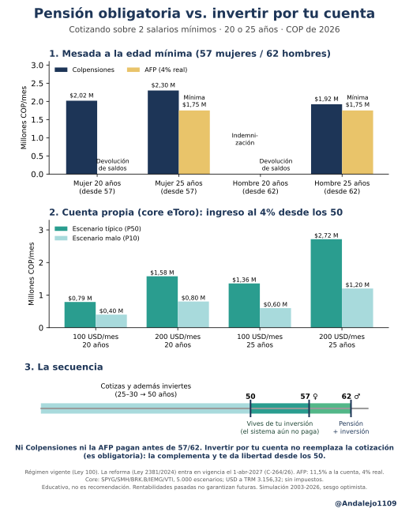

# Pensión obligatoria vs. inversión propia en Colombia

**¿Qué recibe en Colombia alguien que cotiza sobre 2 salarios mínimos durante 20 o 25 años, y qué cambia si además invierte 100 o 200 USD al mes por su cuenta?**

> ⚠️ **Contenido educativo. No es una recomendación de inversión.** Las rentabilidades pasadas no garantizan las futuras. La simulación usa datos de 2003 a 2026, un periodo con sesgo optimista.



## Marco legal
- **Hoy rige la Ley 100 de 1993.** Hay dos regímenes: prima media, que administra Colpensiones (RPM), y ahorro individual en fondos privados o AFP (RAIS).
- **La reforma pensional (Ley 2381 de 2024) todavía no está vigente.** Entra a regir el **1 de abril de 2027**, según la sentencia C-264/26 de la Corte Constitucional. Con ella, el ingreso de cotización hasta 2,3 SMLMV va a Colpensiones y solo lo que pase de ese umbral va a una AFP. Por eso, quien cotiza sobre 2 SMLMV deja de tener ahorro obligatorio en AFP desde esa fecha. En este repo, el caso AFP sirve como referencia del régimen actual.

## Supuestos
- Salario mínimo 2026: $1.750.905. TRM: 3.156,32. Valores en pesos y dólares constantes de 2026.
- `[DEFAULT]` El salario mínimo crece al ritmo de la inflación más 1% al año. La inflación en EE. UU. es 2,5%.
- Requisitos de edad: 57 años las mujeres y 62 los hombres. Semanas: 1.300 los hombres; las mujeres llegan a 1.000 desde 2036. La persona deja de cotizar a los 50.
- **Colpensiones:** tasa r = 65,5 − 0,5·s, más 1,5 puntos por cada 50 semanas adicionales, con tope de 80% y piso de 1 SMLMV. Si no cumple las semanas, recibe indemnización sustitutiva, que se calcula de forma simplificada.
- **AFP:** el 11,5% del salario va a la cuenta individual. Se prueban rentabilidades reales de 3%, 4%, 5% y la histórica de 6,3% que reporta Asofondos. La renta vitalicia se simplifica: interés técnico de 3% real y pagos hasta los 89 años las mujeres y los 85 los hombres. La garantía de pensión mínima exige 1.150 semanas; si no se cumplen, se devuelven los saldos. El bono pensional no aplica.
- **Cuenta propia (core):** 31% SPYG, 22% SMH, 20% BRK.B, 20% IEMG (antes de 2012 se usa EEM) y 7% VTI. Rebalanceo mensual y costo de 5 puntos básicos. Datos de yfinance. Block bootstrap de 12 meses con 5.000 caminos y semilla 42. Se comparan con dos escenarios fijos de 5% y 6% de rentabilidad real. El ingreso sostenible se calcula retirando el 4% al año.

## Resultados (COP de 2026 al mes; AFP al 4% real)
| Caso | Colpensiones | AFP | Cuenta propia: ingreso al 4% desde los 50 (P50 / P10) |
|---|---|---|---|
| Mujer, 20 años | $2,02 M desde los 57 | Devolución de saldos (~$211 M) | 100 USD: $0,79 M / $0,40 M · 200 USD: $1,58 M / $0,80 M |
| Mujer, 25 años | $2,30 M desde los 57 | Garantía de 1 SMLMV | 100 USD: $1,36 M / $0,60 M · 200 USD: $2,72 M / $1,20 M |
| Hombre, 20 años | No cumple semanas: indemnización (~$134 M) | Devolución de saldos (~$256 M) | igual que la mujer de 20 años |
| Hombre, 25 años | $1,92 M desde los 62 | Garantía de 1 SMLMV | igual que la mujer de 25 años |

Ni Colpensiones ni la AFP permiten pensionarse a los 50. En la AFP, la mesada a los 50 sería de apenas 0,25–0,42 SMLMV, por debajo del 110% del salario mínimo que exige la pensión anticipada. Los detalles están en `data/*.csv`.

## Cómo leer la imagen
1. Mesada a la edad mínima en Colpensiones frente a la AFP.
2. Ingreso mensual sostenible desde los 50 con la cuenta propia, en un escenario típico (P50) y uno malo (P10).
3. La secuencia: cotizas e inviertes hasta los 50, vives de tu inversión entre los 50 y los 57/62, y desde ahí recibes la pensión más tu inversión. **La inversión propia complementa la cotización, que es obligatoria para los asalariados; no la reemplaza.**

## Metodología y reproducción
```bash
pip install -r requirements.txt
jupyter nbconvert --to notebook --execute pension_vs_portafolio.ipynb
python post_img.py
```
`sim.py` lee los precios desde un caché parquet. Hay que ajustar esa ruta o descargar SPYG, SMH, BRK-B, IEMG, EEM y VTI con yfinance.

## Limitaciones
- Las rentabilidades de 2003 a 2026 vienen de un periodo excepcional para SMH y las acciones de crecimiento. Ese sesgo optimista es la razón de incluir los escenarios fijos de 5% y 6%.
- No hay impuestos. La TRM se mantiene constante en términos reales, así que el riesgo cambiario no está modelado.
- La renta vitalicia y la indemnización sustitutiva son simplificaciones. Retirar el 4% al año no garantiza que el dinero alcance.

## Fuentes
- Ley 2381/2024: https://www.funcionpublica.gov.co/eva/gestornormativo/norma.php?i=246356
- Corte Constitucional C-264/26: https://www.corteconstitucional.gov.co/relatoria/2026/C-264-26.htm
- Superfinanciera, preguntas sobre la reforma: https://www.superfinanciera.gov.co/publicaciones/10115451/sistema-de-proteccion-social-integral-para-la-vejez-invalidez-y-muerte-de-origen-comun-ley-2381-de-2024/
- Semanas para mujeres: https://www.corteconstitucional.gov.co/noticia.php?corte-declara-inconstitucional-la-exigencia-de-1300-semanas-de-cotizacion-para-que-las-mujeres-obtengan-la-pension-de-vejez-9515=
- Tasa de reemplazo: https://www.gerencie.com/guia-pensiones/tasa-de-reemplazo
- Cotización y AFP: https://www.colfondos.com.co/dxp/empresas/pensiones-obligatorias/que-son
- Rentabilidad histórica de los fondos: https://asofondos.org.co/comunicados/trabajadores-propietarios-464-billones-acumulados-fondos-pensionales/ · contrapunto: http://www.scielo.org.co/scielo.php?pid=S0120-46452019000100070&script=sci_arttext
- Cobertura del 25,4%: https://acoas.com.co/wp-content/uploads/2025/11/6_Mauricio_Olivera.pdf · Asofondos: https://asofondos.org.co/comunicados/informalidad-frenando-futuro-colombianos/
- Informalidad (DANE): https://www.dane.gov.co/index.php/estadisticas-por-tema/mercado-laboral/empleo-informal-y-seguridad-social
- OCDE: https://www.oecd.org/es/publications/ampliar-la-proteccion-social-y-combatir-la-informalidad-en-america-latina_b03f2e18-es/full-report/filling-in-the-gaps-expanding-social-protection-in-colombia_0730c52a.html
- Salario mínimo 2026: https://www.alcaldiabogota.gov.co/sisjur/normas/Norma1.jsp?dt=S&i=192181 · TRM: https://banrep.gov.co/es/estadisticas/trm

## Autor
**Andrés Alejandro Rodríguez Lozano**, economista y científico de datos · [andalejo1109.github.io](https://andalejo1109.github.io) · eToro [@Andalejo1109](https://www.etoro.com/people/andalejo1109)

Licencia MIT.
